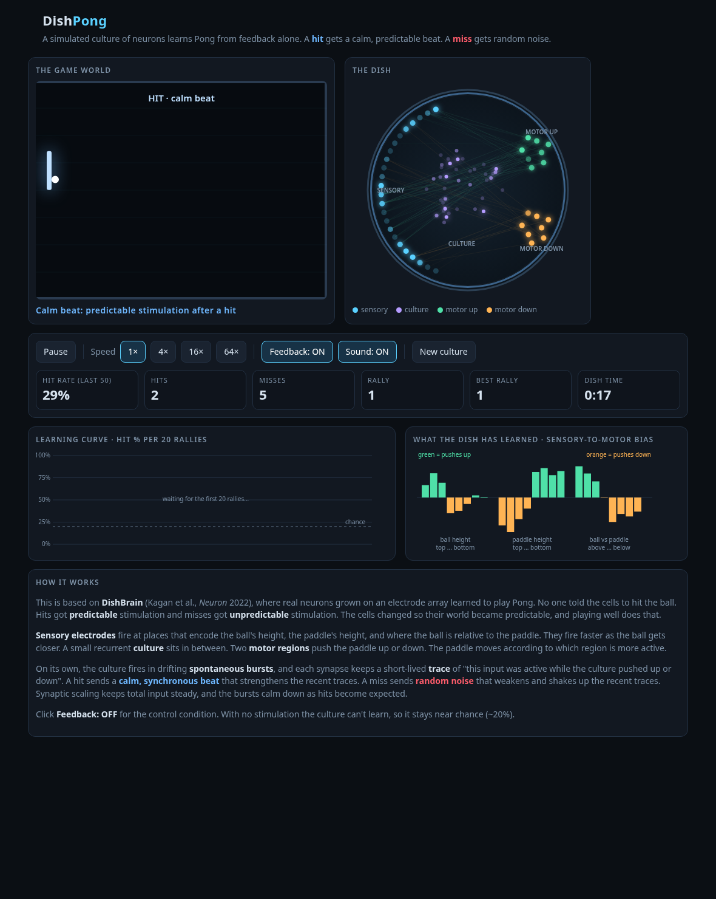
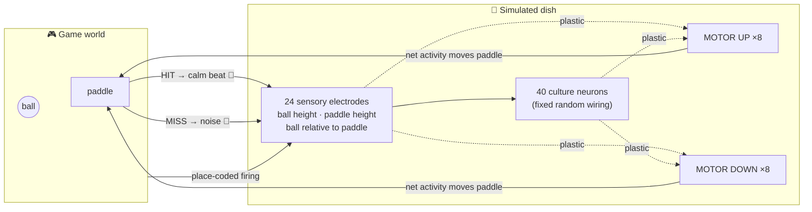

<div align="center">

# 🧫 DishPong

### A Pong player made of simulated neurons that learns from just two signals:<br/>a **calm beat** when it hits the ball, **noise** when it misses.

[](https://asm010101.github.io/DishPong/)
[](https://github.com/ASM010101/DishPong/actions/workflows/ci.yml)
[](#-run-it-locally)
[](LICENSE)

<br/>



<sub>☝️ <b>Recorded from the real simulation</b> by <code>tools/make-readme-media.js</code>. Left: a brand-new culture. Right: the same rules after ~1,300 rallies.</sub>

</div>

---

## ✨ What is this?

In 2022, researchers grew about 800,000 real neurons on an electrode chip and taught them to play Pong ([DishBrain, Kagan et al., *Neuron*](https://doi.org/10.1016/j.neuron.2022.09.001)). They never rewarded the cells. They only made the cells' world **predictable** when the paddle hit the ball and **unpredictable** when it missed. The cells reorganised to keep their world predictable, and doing that meant playing better.

**DishPong** is a small browser version of that idea: about 80 simulated neurons, no backprop, no reward score, no training data.

|  | Event | What the dish receives | What you hear |
|:-:|---|---|---|
| 🔵 | **Hit** | A *calm beat*: every sensory electrode pulses together at a steady rhythm | soft heartbeat thumps |
| 🔴 | **Miss** | *Noise*: random stimulation all over the dish for 1.5 s | a burst of static |

## 📈 It actually gets better

<div align="center">

</div>

The control group runs identical cultures with the feedback switched off, and it stays at chance (~20%). That shows the improvement comes from the beat-vs-noise signal and nothing else. **CI re-checks this on every push**: `npm test` fails if learning doesn't clearly beat the control.

```text
$ npm test
FEEDBACK (learning) — hit % per 100 rallies
   34  43  54  53  69  73  78  87  81  88
   47  67  63  65  79  81  88  90  92  98
   43  54  54  64  77  84  89  93  93  97
   39  51  61  80  79  91  95  90  94  95
  mean: first 40.8%  ->  last 94.5%

NO FEEDBACK (control) — hit % per 100 rallies
   17  26  24  17  25  26  16  18  23  25
   ...
  mean: first 18.8%  ->  last 20.5%

PASS: the culture gets clearly better, the control does not.
```

<sub>Exact numbers vary from run to run because every culture starts with random wiring.</sub>

## 🖥️ The app

<div align="center">

</div>

- **The game world:** a single paddle with walls on the other three sides, like DishBrain. Static fills the screen after a miss, and the paddle glows after a hit.
- **The dish:** every neuron flashes as it fires, and connections brighten as they strengthen.
- **Learning curve:** the hit rate for every 20 rallies, with a chance line for reference.
- **What the dish has learned:** for each sensory cell, a bar shows whether it now pushes the paddle up or down.
- **Controls:** 1× to 64× speed, **Feedback ON/OFF** (run the control experiment yourself), sound toggle, and **New culture**.

## 🧠 How it works



1. **Sensing.** Each electrode fires most when the ball (or paddle) is in its band of the screen, and fires faster as the ball gets closer.
2. **Spontaneous bursts.** Like real cultures, the two motor regions fire in slowly drifting bursts on their own. This is the dish "trying things".
3. **Traces.** Each plastic synapse briefly remembers *"my input was active while the dish pushed UP (or DOWN)"*.
4. **Feedback gates plasticity.**
   - 🔵 The **calm beat** after a hit strengthens the recent traces: *do more of that*.
   - 🔴 The **noise** after a miss weakens and scrambles them: *not that*.
   - Each update is scaled by **surprise**: an unexpected hit counts for more than an expected one.
5. **Homeostasis.** Synaptic scaling keeps each neuron's total input constant. The bursts also quiet down as hits become expected, so a calm dish settles into what works.

> [!NOTE]
> This is an *inspired-by* toy model, not a biophysical simulation. Real DishBrain cultures are far richer, and how they learn is still being studied. The rule here is a reward-modulated Hebbian stand-in for the "keep your world predictable" (free-energy) idea.

## 🚀 Run it locally

There's no build step and nothing to install. Clone the repo and open the page:

```bash
git clone https://github.com/ASM010101/DishPong.git
cd DishPong
open index.html        # macOS  ·  Linux: xdg-open index.html  ·  Windows: start index.html
```

Then **turn your sound on, click the game, and hit 64×**. Within about a minute you'll watch it go from flailing to rallying.

Run the headless learning test (needs [Node.js](https://nodejs.org) 18+):

```bash
npm test                          # learning vs control, ~20 s
node test-learning.js 3000 200    # longer run, 3000 rallies in blocks of 200
```

> [!TIP]
> In the browser console, `dishpong.train(200000)` fast-forwards learning instantly, and `dishpong.dish.hitRate()` shows the current hit rate.

## 🗂️ Project layout

```text
DishPong/
├── index.html            # UI: canvas rendering, Web Audio, controls
├── dish.js               # neurons, plasticity rule, game physics (no DOM, runs in Node too)
├── test-learning.js      # proves learning vs a no-feedback control (used by CI)
├── docs/                 # README media (generated from real runs)
├── tools/
│   ├── make-readme-media.js   # regenerates docs/demo.svg and docs/learning-curve.svg
│   ├── sweep.js / ideal.js / signal.js / motion.js   # tuning and diagnostics
│   └── make-*-test.js         # headless-browser helpers
└── .github/workflows/    # CI (learning test) and GitHub Pages deploy
```

Regenerate the README animations after changing the model:

```bash
npm run media
```

## 🌐 Live demo setup (one time)

The included workflow publishes the game to **https://asm010101.github.io/DishPong/** on every push to `main`. If the first deploy fails, go to **Settings → Pages → Build and deployment → Source** and choose **GitHub Actions**, then re-run the workflow.

## 📚 References

- Kagan, B. J. et al. (2022). *In vitro neurons learn and exhibit sentience when embodied in a simulated game-world.* **Neuron** 110(23). [doi:10.1016/j.neuron.2022.09.001](https://doi.org/10.1016/j.neuron.2022.09.001)
- Friston, K. (2010). *The free-energy principle: a unified brain theory?* **Nature Reviews Neuroscience** 11. [doi:10.1038/nrn2787](https://doi.org/10.1038/nrn2787)

## 📄 License

[MIT](LICENSE). Fork it, remix it, and grow your own dish. 🧫
